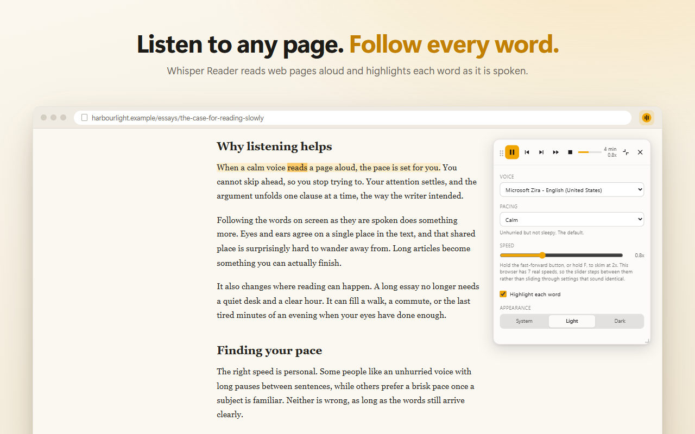
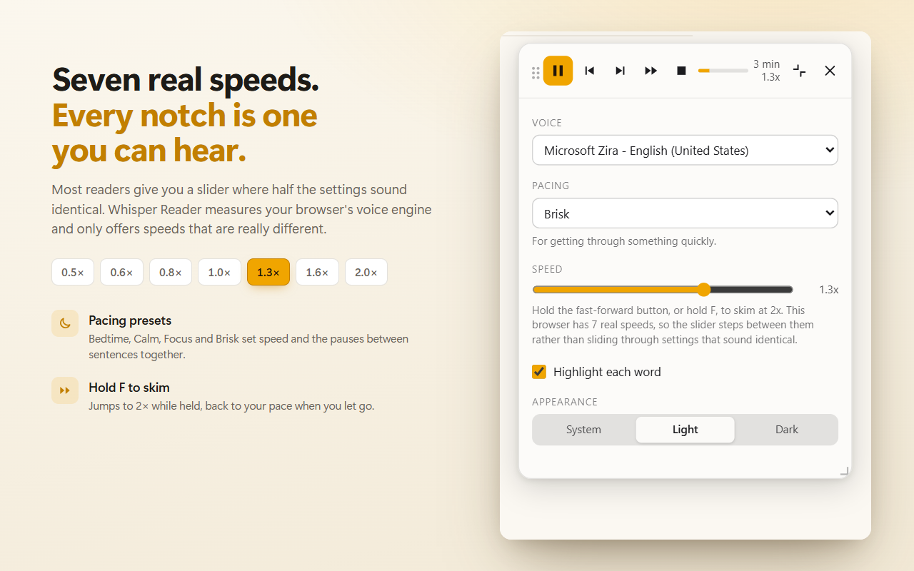
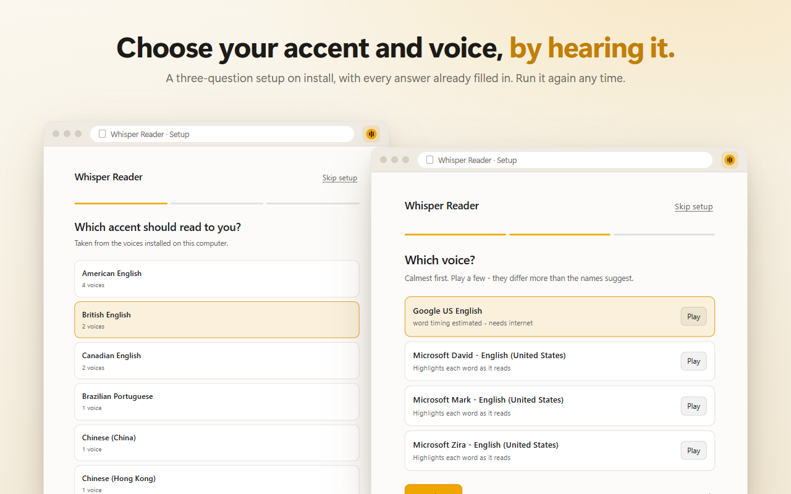
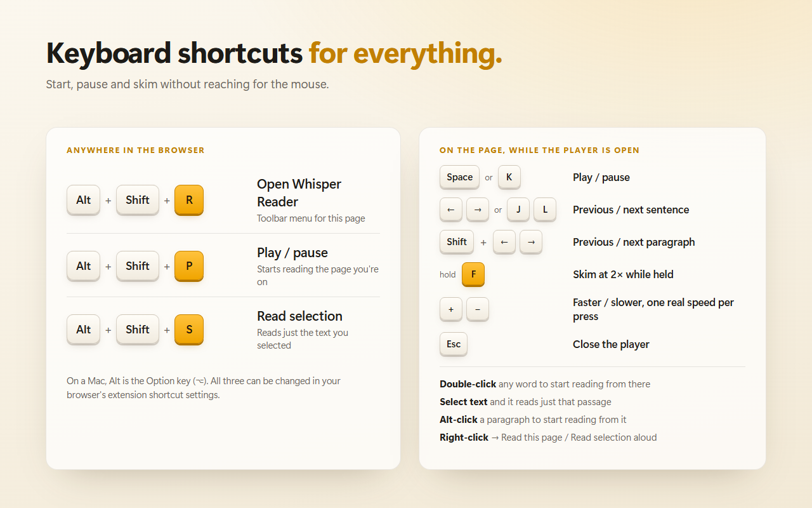
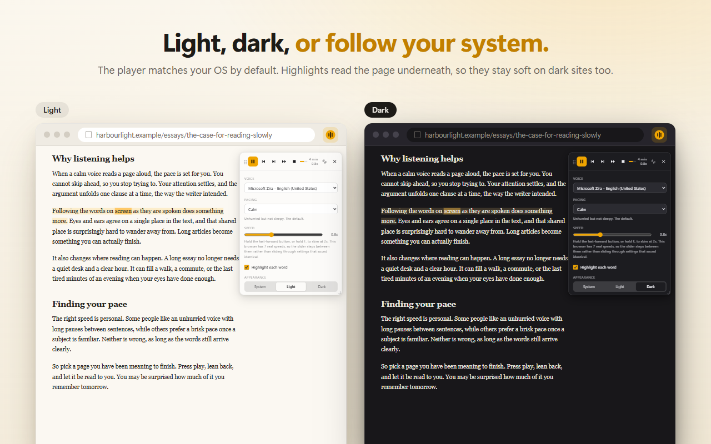
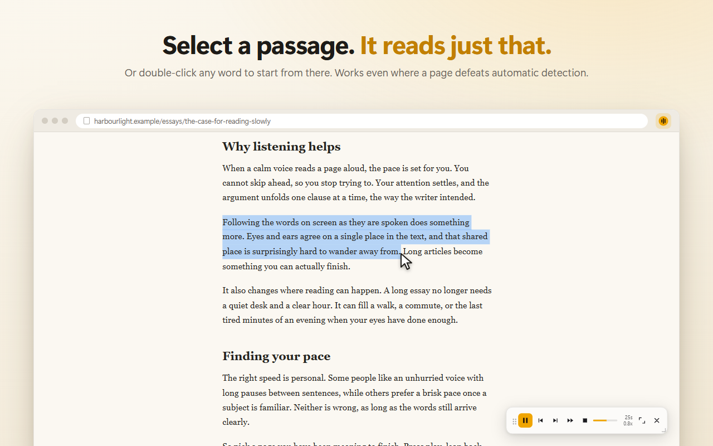

<p align="center"></p>

<h1 align="center">Whisper Reader</h1>

<p align="center">
  <b>Listen to any page. Follow every word.</b><br>
  A free, open-source text-to-speech extension for Chrome and Firefox. It reads
  web pages aloud in a calm voice and highlights each word as it is spoken.
</p>

https://github.com/user-attachments/assets/dea912a7-beef-4c94-94a7-743ee9d8e8ed

## Features

- **Word-by-word highlighting** that tracks the voice, on any page, without
  modifying the page.
- **Seven real speeds.** The speed control only offers speeds your browser's
  voice engine can actually produce, so every notch is one you can hear.
- **Pick your accent and voice by hearing them**, in a three-question setup on
  install.
- **Keyboard shortcuts for everything**, plus double-click any word to start
  there, or select a passage to read just that.
- **Light, dark, or follow your system.**
- **Picks up where you stopped** on long articles.
- **Private by design:** no account, no analytics, no network requests at all.
  It speaks with the voices already on your computer.

## Screenshots

| | |
|---|---|
|  |  |
|  |  |
|  |  |

Every image and the video are rendered from the real extension UI by
`npm run media` -- see [Store media](#store-media).

## Installing it in Chrome

```bash
npm install && npm run build
```

Then in Chrome: open `chrome://extensions`, turn on **Developer mode**
(top right), click **Load unpacked**, and choose the `.output/chrome-mv3`
folder. Pin Whisper Reader to the toolbar.

Open any article, click the icon, and press **Read this page**. The player
appears on the page itself — drag it by the grip, drag the bottom-right corner
to resize, and use the arrows icon to switch between compact and full.

`npm run zip` produces `.output/whisper-reader-0.1.0-chrome.zip` for distribution.

## Installing it in Firefox

Firefox needs its **own build**. `npm run build` produces the Chrome target
only, and pointing Firefox at that one fails with:

> background.service_worker is currently disabled. Add background.scripts.

That error means you selected `.output/chrome-mv3/manifest.json`. Chrome MV3
runs its background as a service worker; Firefox MV3 runs it as an event page,
so the two manifests genuinely differ:

| | Chrome | Firefox |
|---|---|---|
| build | `.output/chrome-mv3` | `.output/firefox-mv3` |
| background key | `"service_worker": "background.js"` | `"scripts": ["background.js"]` |

So:

```bash
npm run build:firefox
```

Then open `about:debugging#/runtime/this-firefox`, choose **Load Temporary
Add-on**, and select `.output/firefox-mv3/manifest.json` — note **firefox**-mv3,
not chrome-mv3.

To build both at once:

```bash
npm run build:all
```

Temporary add-ons are removed when Firefox restarts; that is Firefox's
behaviour, not a bug in the extension.

### Controls

| | |
|---|---|
| Space or K | play / pause |
| J / L, or arrow keys | previous / next sentence |
| Shift with either | jump a whole paragraph |
| Hold F | 2x while held |
| + / - | faster / slower, one real speed per press |
| Select any text | reads it, starting where the selection starts |
| Double-click a word | start reading from that exact word |
| Alt+click a paragraph | start reading from that paragraph |
| Escape | close the player |

Alt+Shift+R opens the popup, Alt+Shift+P plays or pauses, and Alt+Shift+S reads
the current selection, from anywhere.

### What it does that others do not

- **Word-level highlighting that actually tracks the voice**, resolved through
  a piece table rather than by searching for text, so it stays correct through
  whitespace collapse, stripped footnote markers and expanded abbreviations.
- **Time left**, calibrated from how fast your voice really speaks rather than
  a words-per-minute guess, so it sharpens as you listen.
- **Picks up where you stopped.** Come back to a long article tomorrow and the
  cursor is on the sentence you left. Matched by sentence text, not index, so
  it survives the page gaining a banner or a lazy-loaded section. No UI at all;
  Stop clears the bookmark.
- **Select any text and it reads it**, bypassing every content heuristic. No
  page can defeat it.
- **Never mutates the page.** Highlighting uses the CSS Custom Highlight API,
  so React and Vue sites do not reconcile and break underneath it.
- **A speed control that only offers speeds that exist.** Most extensions hand
  you a continuous 0.5–3x slider; on Chromium/Windows the engine has seven real
  speeds, so most of that travel does nothing and the rest jumps 26% at a time.
  Whisper Reader measures its own engine, silently, and steps between the speeds
  that are actually there. See **Measured engine behaviour**.
- **No permissions at install, no account, no network.**

### First-run setup

On install, a one-page setup asks three questions — accent, voice, and
listening speed — with every answer pre-filled and a **Play** button on each
voice, because the only way to choose a voice is to hear it. Skipping it is a
real option, not a trap, and **Choose voice and speed** in the popup reopens it
whenever voices are added or removed.

While the first question is on screen it silently measures the engine's real
speeds, so the speed question offers the right ones.

### Appearance

The player follows your OS light/dark setting by default; **Appearance** in the
full panel forces Light or Dark instead, and the choice wins over the OS in
both directions. It applies to the panel and the toolbar popup.

The on-page highlight is deliberately *not* tied to that setting. It has to stay
legible against the page's own background, which is usually white whatever the
OS is set to, so it picks its tint from the measured luminance of the page
itself (`pageIsDark` in `lib/highlight/theme.ts`).

## Development

```bash
npm run dev
```

## Checks

```bash
npm test
```

```bash
npm run harness:real
```

`harness:real` runs the extraction pipeline against live published pages and
reports what the reader would actually say. **Ignore its parse-time numbers** --
jsdom's `getComputedStyle` dominates them. Measured on the same Wikipedia
article: 15,800 ms under jsdom, 96 ms cold and ~50 ms warm in Chrome.

```bash
npm run harness:serve
```

Serves a test article at `http://localhost:5399/page/` with the whole reader
bundled in, minus the extension plumbing. `await __calmStart()` in the console
gives you a live player to drive. This is how the visual half gets checked:
unit tests cannot tell you whether the highlight actually paints.

## Store media

```bash
npm run media
```

Renders every store image and the demo video from the **real extension UI** —
the actual panel, highlighter, collector and setup page, put into exact states
and photographed by headless Chrome. No mockups, so the screenshots cannot
drift from what installs. Outputs:

| File | Use |
|---|---|
| `assets/store/screenshot-1…5-*.png` | Chrome Web Store screenshots (1280×800, max 5) |
| `assets/store/screenshot-6-select.png`, `-7-setup.png` | Extra screenshots for Firefox Add-ons |
| `assets/store/promo-small-440x280.png` | Chrome Web Store small promo tile |
| `assets/store/promo-marquee-1400x560.png` | Chrome Web Store marquee promo tile |
| `assets/store/github-social-preview-1280x640.png` | GitHub → Settings → Social preview |
| `assets/video/whisper-reader-demo.mp4` | Upload to YouTube for the store's promo video field |
| `assets/video/whisper-reader-demo.gif` | The animation at the top of this README |

The video's narration is the real Windows SAPI voices, rendered by
`scripts/media/narrate.ps1` with every word's audio position recorded, so the
highlighting lands on each word as it is actually spoken. Pauses between
sentences follow the controller's own pacing rules. Off Windows, the committed
narration in `scripts/media/narration/` is reused.

`npm run media slides` or `npm run media video` renders just one half. Needs
Chrome; the GIF needs Python with Pillow. Everything else — the MP4 encoding
included — is done by Chrome itself, with no ffmpeg or npm packages. See
`scripts/media/README.md`.

## How it fits together

```
background.ts        injects the reader on demand (activeTab only), routes
                     commands and context menus. Never speaks -- speechSynthesis
                     does not exist in an MV3 service worker.
   |
reader.ts            assembles everything in the page, owns the keyboard
   |
   +-- lib/extract   DOM -> ordered speakable blocks
   +-- lib/engines   one interface, three tiers behind it
   +-- lib/player    the transport FSM and word timing
   +-- lib/highlight two non-destructive ways to paint a range
   +-- ui/panel      the in-page player
```

### The load-bearing decisions

**`lib/extract/offsets.ts` is the piece to understand first.** Spoken text and
DOM text diverge the moment anything is normalised -- collapsing whitespace
deletes characters, stripping `[1]` deletes more, and expanding "e.g." into
"for example" inserts eleven characters that exist in no text node. Rather than
searching for text after the fact, the builder records a piece table while
constructing the string. Every highlight in the product resolves through
`rangeFor`.

**Nothing mutates the page.** Highlighting uses the CSS Custom Highlight API,
falling back to absolutely-positioned rectangles in a shadow-rooted overlay.
Wrapping text in `<mark>` would make React and Vue reconcile and would detach
the very nodes we track.

**Speech is chunked per sentence.** That is what makes skip and rewind exact,
lets us put real pauses between sentences (most of what makes a voice sound
calm), and keeps every utterance short enough to dodge Chrome's
long-utterance bug.

**The player is an in-page panel, not the toolbar popup.** A browser action
popup cannot be resized by the user and closes the moment it loses focus.

**A default install requests no host permissions.** The reader is an unlisted
script injected on demand, so `activeTab` genuinely covers it. `<all_urls>` is
optional-only, for a future "auto-start on this site".

### Known browser misbehaviour we work around

- `speechSynthesis.cancel()` fires `onend` with nothing to distinguish it from
  a natural finish. A generation counter drops stale callbacks; without it every
  skip advances twice.
- `pause()`/`resume()` can silently discard the utterance on Chrome. The
  controller checks `speaking` shortly after resuming and re-speaks from the
  current word.
- Chrome's Google network voices emit no boundary events at all. Voices are
  probed once, the verdict is cached, and the picker labels them honestly
  rather than shipping a feature that quietly does nothing.
- Web Speech cannot retune a live utterance, so a rate change restarts the
  sentence from the current word. On the cloud and on-device tiers this becomes
  a seamless `playbackRate` change.

## Not supported

Browser-internal pages, extension stores, PDFs, and cross-origin iframes.
Playback stops when the tab navigates or closes.

## When a page will not read

Selecting text always works, whatever the page does. A selection is the user
saying exactly what they want read, so it is collected with `trustEverything`
and bypasses every visibility and page-furniture rule the whole-page read
applies. Verified: a footer excluded from a normal read is still read aloud
when it is selected.

The only two exemptions that survive `trustEverything` are `<script>`/`<style>`
and the reader's own panel — it must never read itself.

If a whole-page read finds nothing, the panel and the popup now say so and
point at selecting text, rather than leaving a play button that silently does
nothing.

## Page coverage

The collector reads a page once, from the first `<article>`, `<main>` or
`[role=main]` holding real text, falling back to `<body>`. Four traps cost real
content before they were found, all by measurement rather than inspection:

- **`checkVisibility()` returns false for `display: contents`.** Such an element
  generates no box of its own while its children render perfectly normally.
  Tailwind ships it as the `contents` class and React wrappers lean on it, so
  trusting that `false` silently swallowed entire articles. A `true` is
  conclusive; a `false` is now re-checked against the computed properties.
- **`opacity: 0` is not hidden.** Scroll-reveal animations hold sections at zero
  opacity until they enter the viewport, and the whole document is collected up
  front while most of it is still below the fold.
- **Inline `<code>` is prose.** Only `<pre>` is skipped; dropping every `<code>`
  left holes mid-sentence on technical pages.
- **An `<h1>` inside a `<header>` is an article title**, not site chrome, so
  that one header is exempt from the body-level chrome filter.

A landmark that collects almost nothing is treated as a shell and the page is
re-read from `<body>`. Content that appears after injection — hydration, lazy
loading, "read more" — is picked up by a re-scan when playback starts, which
re-anchors on the sentence being read.

To see what a page yields and where the rest went:

```bash
npm run harness:real -- https://example.com/article
```

It prints coverage against the root actually read, plus every filter that
dropped text and how much. Coverage below 100% is not automatically a bug:
navigation and footers *should* be dropped. Read the reasons, not the score.

## Measured engine behaviour

Two of the bugs fixed in this project were only diagnosable by measurement, and
the numbers drive real constants in the code.

**Speed is a staircase, not a slider.** Chromium on Windows does not pass
`rate` to the speech engine. It converts it to SAPI's integer rate scale with
`trunc(10 * log10(rate))`, so whole ranges of requested rates collapse onto one
real speed. Measured with one fixed 71-character sentence at volume 0 — silent
utterances still take their full time and fire every event, which is what makes
this measurable without making a noise:

| requested | 0.5 | 0.6 | 0.63 | 0.7 | 0.79 | 0.8 | 0.9 | 1.0 |
|---|---|---|---|---|---|---|---|---|
| duration (ms) | 5837 | 5209 | 5211 | 4707 | 4702 | 4320 | 4317 | 4316 |
| engine step | -3 | -2 | -2 | -1 | -1 | 0 | 0 | 0 |

| requested | 1.1 | 1.2 | 1.3 | 1.4 | 1.5 | 1.6 | 1.7 | 1.8 | 1.9 | 2.0 |
|---|---|---|---|---|---|---|---|---|---|---|
| duration (ms) | 4310 | 4311 | 3721 | 3725 | 3719 | 3381 | 3370 | 3361 | 3381 | 2963 |
| engine step | 0 | 0 | 1 | 1 | 1 | 2 | 2 | 2 | 2 | 3 |

Durations inside a step agree to 0.2%; across a step they differ by 9–12%.
There are exactly **seven real speeds** between 0.5x and 2x, at `10^(n/10)`.

Two things follow, and both were shipped wrong before this was measured:

- **Dragging the speed slider mostly did nothing, then jumped a whole 26% step
  at once.** That jump into a more compressed engine rate is what gets heard as
  the voice starting to mumble — there is no gentle way up, because the engine
  has no intermediate speed to offer. The slider now steps through the seven
  real speeds, so every notch is an audible change and none is a leap.
- **0.8, 0.9 and 1.0 are the same speed.** The Bedtime, Calm and Focus presets
  were three labels on one identical pace. They are now 0.63, 0.79, 1.0 and 1.3,
  which land on four different engine steps.

An earlier measurement sampled only 2.0 and 2.5, found them identical, and
concluded the engine plateaus above 2.0. It does not — 2.5 simply falls in the
same bucket, since `10^0.4` is 2.512. 3.0 and 4.0 are measurably faster still.
The 2.0 ceiling stays, but for the honest reason: step 3 is the fastest that
still articulates.

Whether an engine quantizes is **probed, not assumed** — Firefox and macOS have
a continuous rate, and Chrome's network voices resample real audio. The probe
times two silent phrases at 0.9 and 1.0 and compares them, caches the verdict
in `storage.local`, and falls back to the finer ladder when it cannot tell.
See `lib/player/rate.ts` and `lib/engines/rate-probe.ts`.

Inter-sentence pauses scale by `1 + (rate - 1) * 0.55` rather than by the
requested rate, since 2.0 buys about 1.46x of real speedup and dividing the
gaps by 2 clips them far too short.

**`pause()` lies.** It sets `speechSynthesis.paused` within 11 ms while
`speechSynthesis.speaking` stays true and the voice audibly continues. Engines
declare `reliablePause` in their capabilities; when it is false the controller
cancels and remembers the word instead, which stops instantly.

## Project status

| Phase | | Notes |
|---|---|---|
| 0 Scaffold | done | Chrome MV3 + Firefox MV3 from one codebase |
| 1 Text pipeline | done | Verified against live Wikipedia, 0 unresolved ranges |
| 2 Playback core | done | Verified end to end with real audio |
| 3 Word highlighting | mostly | Native + estimated clock built; overlay fallback untested on Firefox < 140 |
| 4 Panel UX | mostly | Panel, popup, shortcuts, context menus built; drag/resize not yet automated-tested |
| 5 Calm polish | done | Pacing presets; guidance toward better system voices |
| 6 Cloud tier | **dropped** | Superseded by the free on-device model |
| 7 Kokoro on-device | **abandoned** | Not viable in-browser -- see below |
| 8 Page coverage | mostly | display:contents, opacity, inline code, article titles; re-scan on play |
| 9 Ship | done | Icons, store listing answers, privacy policy, store media |

## Kokoro: what the investigation found

Kokoro-82M was the intended source of the calm voices (Heart, Bella, Echo,
Liam). It is **not integrated**, because no configuration was both fast enough
and correct -- reproduced independently on two machines, including one with a
discrete NVIDIA GPU.

| model | device | realtime factor | audio |
|---|---|---|---|
| q8 (92 MB) | WASM, 1 thread | 7.9 | valid |
| q8 (92 MB) | WASM, 8 threads | 5.5 | valid |
| q8 (92 MB) | WebGPU | no output in 2 min | -- |
| fp16 (163 MB) | WASM, 8 threads | 3.8 | untested |
| fp16 (163 MB) | WebGPU | **0.32** | **100% NaN** |

Realtime factor is synthesis time over audio duration. Below ~0.6 the
sentence-lookahead scheduler stays ahead of playback; above 1.0 the reader
stutters.

The fp16/WebGPU row is the important one, and the reason this repo now checks
waveforms rather than stopwatches: it was three times faster than realtime
*because* it was producing non-finite garbage. Timing alone would have shipped
silence. The adapter is a real NVIDIA Lovelace GPU, not a software fallback, so
this looks like an ONNX Runtime WebGPU kernel problem rather than a bad
environment.

On a second machine, ORT logged
`VerifyEachNodeIsAssignedToAnEp: Some nodes were not assigned to the preferred
execution providers` and every configuration came back *too slow* or *broken
output*. That warning is benign in itself, but it names the cause: nodes
falling back to CPU mean a GPU round trip per step.

**Conclusion: the calm voices come from pacing and from the operating system's
own neural voices, not from Kokoro.** The extension ships the presets in
`lib/player/presets.ts` and, when every available voice scores poorly, points
the user at the free neural voices Windows and macOS already have
(`lib/engines/voice-advice.ts`).

The tester and the `kokoro-js` dependency have been removed so the project has
**zero runtime dependencies**. `tests/harness/kokoro-probe.ts.disabled` keeps
the measurement code; to run it again, rename it and
`npm i -D kokoro-js @huggingface/transformers`.

### Constraints any future Kokoro work must satisfy

- **Inference must run in a Worker.** On the main thread it froze the page hard
  enough to make the tab unresponsive for a minute at a time.
- **The ONNX runtime has to be bundled**, not fetched -- MV3 forbids remotely
  hosted code. Model *weights* are data and may be downloaded.
- **Bundle with the `onnxruntime-web-use-extern-wasm` resolve condition.**
  Without it the package silently gets `ort.bundle.min.mjs`, which base64s
  32 MB of wasm into the JavaScript: a 60 MB bundle instead of 3.2 MB.
- **WASM threading needs cross-origin isolation**, available to MV3 extension
  pages via the `cross_origin_embedder_policy` / `cross_origin_opener_policy`
  manifest keys. It bought only 7.9 -> 5.5, so it does not rescue the CPU path.
- `model_q8f16.onnx` (86 MB, the smallest variant in the repo) is unreachable:
  transformers.js validates `dtype` against a closed list that excludes it.

## Licence

MIT — see `LICENSE`. Everything here is free to use, modify and redistribute.

- **No paid services, accounts or API keys.** Speech comes from the browser's
  own Web Speech API, which is free and runs on the user's machine.
- **No runtime dependencies.** Nothing third-party ships in the extension; the
  bundle is this repository's own code.
- **Build-time dependencies are all permissive** (MIT, Apache-2.0, ISC, BSD).
  The one exception worth naming is `lightningcss`, which is MPL-2.0 and
  reaches the project transitively through Vite. MPL-2.0 is file-level
  copyleft on its own source, it is a build tool, and none of it is
  redistributed in the extension, so it does not affect this licence.
